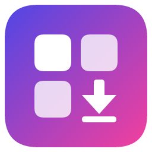
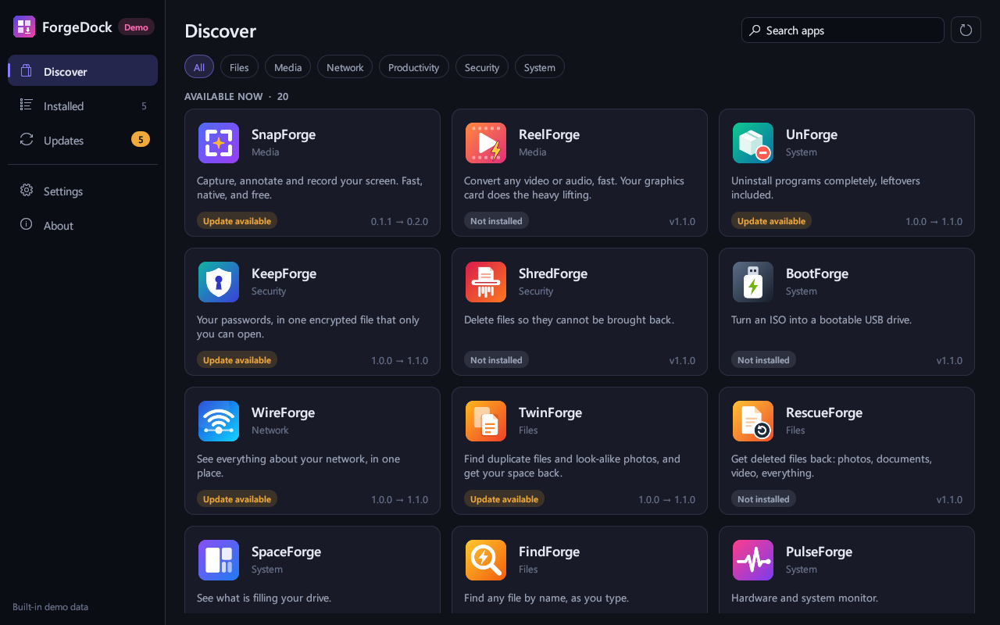
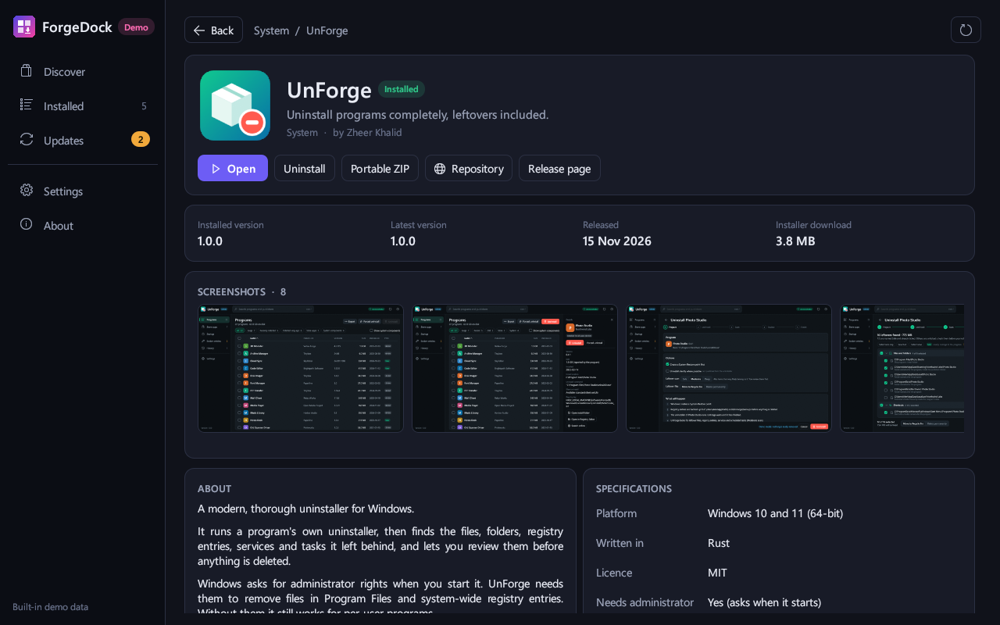
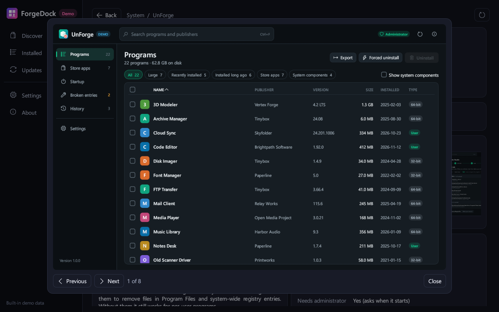
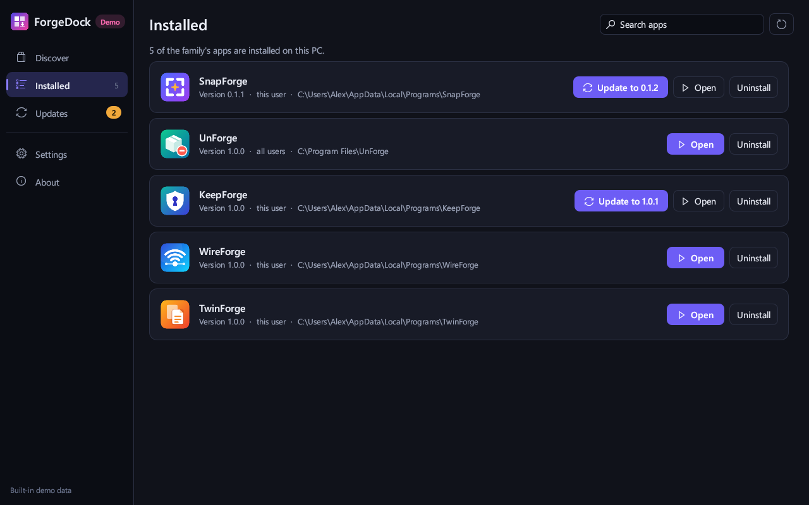
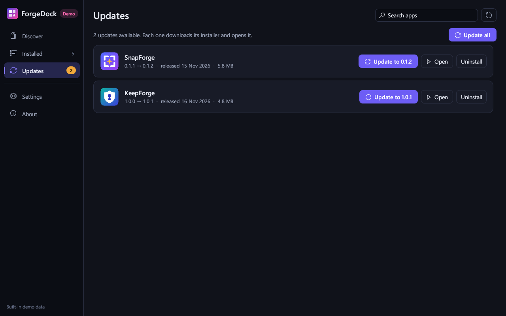
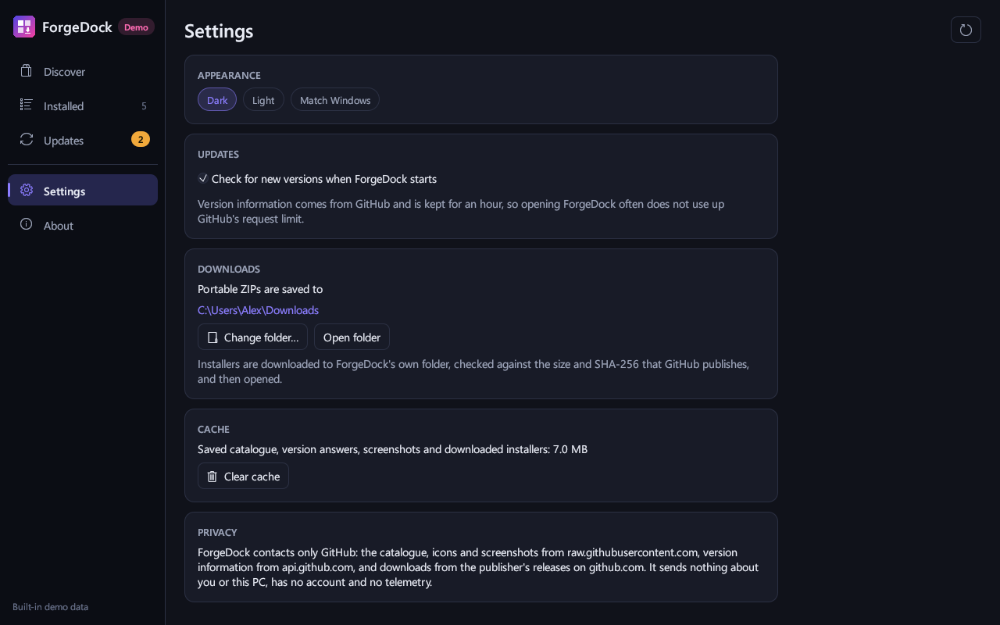
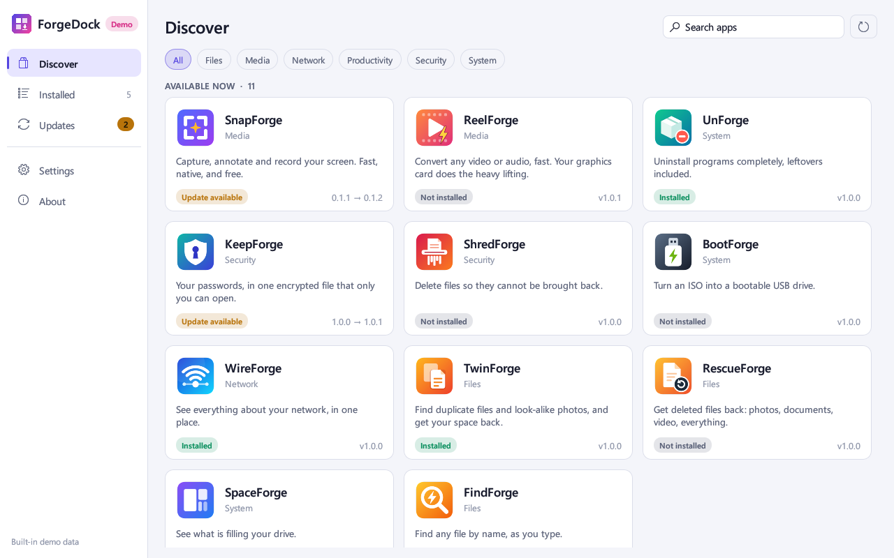

<div align="center">



# ForgeDock

### One place to discover, install and update every Forge app.

The app manager for the Forge family of Windows apps, written in **Rust**.
Browse the apps with descriptions, screenshots and specifications, install them in a click, and see at a glance which ones have an update.

<p>
  
  
  
  
</p>

<p>
  
  
  
  
  
</p>

[**Features**](#-features) ·
[**The apps**](#-the-apps) ·
[**Screenshots**](#%EF%B8%8F-screenshots) ·
[**Download**](#-download) ·
[**How it works**](#-how-it-works) ·
[**Developer**](#-developer)



</div>

---

## ✨ Features

<table>
<tr>
<td width="50%" valign="top">

### 🛍️ Discover
- Every Forge app as a card: icon, name, what it does, category
- Status on each card: Installed, Update available, Not installed, Coming soon
- Search and category filters
- Dark and light themes

</td>
<td width="50%" valign="top">

### 📄 App pages
- Description and feature list
- **Screenshot gallery**, click to enlarge
- Specifications: platform, licence, whether it needs administrator rights, size
- Installed version, latest version, release date and download size
- Release notes of the latest version

</td>
</tr>
<tr>
<td valign="top">

### ⬇️ Install and update
- **Install** downloads the app's installer with a progress bar and starts it
- **Update** when a newer version is out, and **Update all**
- **Portable ZIP** download to a folder of your choice
- Open an installed app, or uninstall it after a confirmation

</td>
<td valign="top">

### 🔒 Careful by design
- Downloads come only from the apps' own GitHub releases, over HTTPS; any other host is refused
- Download size is checked, and the SHA-256 digest when GitHub provides one
- Nothing about you or your PC is sent anywhere
- Works offline with a built-in copy of the catalogue

</td>
</tr>
</table>

## 🧩 The apps

| App | What it does |
|---|---|
| [SnapForge](https://github.com/zheerkhalid/snapforge) | Screen capture, annotation and recording |
| [ReelForge](https://github.com/zheerkhalid/reelforge) | Video and audio converter |
| [UnForge](https://github.com/zheerkhalid/unforge) | Uninstaller that removes leftovers |
| [KeepForge](https://github.com/zheerkhalid/keepforge) | Offline password manager |
| [ShredForge](https://github.com/zheerkhalid/shredforge) | Secure file, folder and disk shredder |
| [BootForge](https://github.com/zheerkhalid/bootforge) | Bootable USB creator |
| [WireForge](https://github.com/zheerkhalid/wireforge) | Network and Wi-Fi monitor |
| [TwinForge](https://github.com/zheerkhalid/twinforge) | Duplicate file and similar-photo finder |
| [RescueForge](https://github.com/zheerkhalid/rescueforge) | File recovery |
| [SpaceForge](https://github.com/zheerkhalid/spaceforge) | Disk space analyzer |
| [FindForge](https://github.com/zheerkhalid/findforge) | Instant file search |
| [PulseForge](https://github.com/zheerkhalid/pulseforge) | Hardware and system monitor |
| [SocketForge](https://github.com/zheerkhalid/socketforge) | Ports viewer and hosts-file editor |
| [HourForge](https://github.com/zheerkhalid/hourforge) | Private automatic time tracker |
| [VeilForge](https://github.com/zheerkhalid/veilforge) | File and folder locker |
| [PrivacyForge](https://github.com/zheerkhalid/privacyforge) | Windows privacy and debloat, with undo |
| [MetaForge](https://github.com/zheerkhalid/metaforge) | Metadata viewer and cleaner |
| [DisplayForge](https://github.com/zheerkhalid/displayforge) | Monitor brightness, night light and profiles |
| [PowerForge](https://github.com/zheerkhalid/powerforge) | Battery health, power plans and sleep diagnostics |
| [EventForge](https://github.com/zheerkhalid/eventforge) | PC problems explained in plain language |

## 🖼️ Screenshots

<table>
<tr>
<td width="50%" align="center"><b>App page</b><br></td>
<td width="50%" align="center"><b>Screenshot gallery</b><br></td>
</tr>
<tr>
<td width="50%" align="center"><b>Installed</b><br></td>
<td width="50%" align="center"><b>Updates</b><br></td>
</tr>
<tr>
<td width="50%" align="center"><b>Settings</b><br></td>
<td width="50%" align="center"><b>Light theme</b><br></td>
</tr>
</table>

<sub>Screenshots use the built-in demo mode (<code>ForgeDock.exe --demo</code>), with an invented set of installed apps.</sub>

## 📥 Download

Get it from the [**latest release**](https://github.com/zheerkhalid/forgedock/releases/latest):

| File | What it is |
|---|---|
| `ForgeDock-Setup.exe` | Per-user installer with shortcuts and an uninstaller |
| `ForgeDock-x.y.z-portable-x64.zip` | Portable: unzip and run |
| `ForgeDock.exe` | The bare 5.0 MB EXE |

## ⚙️ How it works

- **The catalogue** is [`catalog.json`](catalog.json) in this repository. ForgeDock fetches it when it starts, so a new app appears without a new version of ForgeDock.
- **Versions and downloads** come from each app's latest GitHub release. GitHub allows 60 such requests an hour without an account; ForgeDock caches answers for an hour and says so if the limit is reached.
- **Installed apps** are found from Windows' own list of installed programs.
- **Installing** runs the app's normal installer; you complete it as usual.

Good to know:

- This is a first release. Downloading, version checks and installed-app detection have been tested by running them; the Install, Update and Uninstall buttons have not yet been clicked through by hand.
- "Update all" opens each installer as its download finishes, so several can be open at once.
- ForgeDock does not update itself yet; get new versions from this page.

## 📝 Changelog

See [`CHANGELOG.md`](CHANGELOG.md).

## 🏗️ Build from source

Requires Rust (stable, MSVC toolchain) on Windows.

```powershell
git clone https://github.com/zheerkhalid/forgedock
cd forgedock
cargo build --release
# -> target\release\ForgeDock.exe
cargo test
```

The icon is drawn in code at build time. The C runtime is linked statically, so the EXE runs on a clean Windows install.

## 👨‍💻 Developer

<table>
<tr>
<td align="center" width="140">
  <a href="https://zheer.dev">
    
  </a>
</td>
<td>

**Designed and developed by [Zheer Khalid](https://zheer.dev)**

🌐 Website: **[zheer.dev](https://zheer.dev)**  
🐙 GitHub: **[@zheerkhalid](https://github.com/zheerkhalid)**

If ForgeDock is useful to you, a ⭐ on the repo is appreciated.

</td>
</tr>
</table>

## 📄 License

MIT © 2026 [Zheer Khalid](https://zheer.dev). See [`LICENSE`](LICENSE).

<div align="center">
<sub>Built with 🦀 Rust and ❤️ by <a href="https://zheer.dev">zheer.dev</a></sub>
</div>
